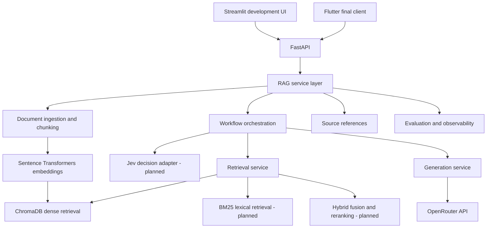

# Intelligent RAG System — Architecture

**Status:** Initial design  
**Project phase:** Day 1 — Foundation  
**Goal:** Build a document question-answering system that retrieves evidence, produces grounded answers with source references, and improves through measured evaluation.

---

## 1. Project Goals

The system will:

- Accept and index user-provided documents.
- Retrieve relevant passages in response to questions.
- Generate answers grounded in retrieved evidence.
- Return source references with answers and abstain when evidence is insufficient.
- Support dense retrieval, hybrid retrieval, reranking, and query rewriting as measurable upgrades.
- Use Jev for structured decision-making if its verified capabilities improve workflow routing.
- Expose a stable backend API to a temporary Streamlit UI and, ultimately, a Flutter client.
- Include automated tests, evaluation, observability, and security controls.

## 2. High-Level Architecture



This diagram describes the target direction. The first implementation will be simpler and will not require Jev, LangGraph, hybrid retrieval, or reranking to work.

## 3. Technology Stack

| Area | Initial choice | Role |
|---|---|---|
| Language | Python | Application and RAG logic |
| API | FastAPI | HTTP endpoints and request validation |
| RAG integrations | LangChain | Document, retriever, and model integrations |
| Workflow orchestration | LangGraph, introduced when useful | Stateful and conditional workflows |
| Decision-making | Jev, pending interface verification | Structured decisions or routing where beneficial |
| Vector database | ChromaDB | Local dense-vector storage and retrieval |
| Embeddings | Sentence Transformers | Local text embeddings |
| LLM access | OpenRouter API | Answer generation using a selected supported model |
| Temporary UI | Streamlit | Rapid development and testing |
| Final UI | Flutter | User-facing application |
| Tests | pytest | Unit, integration, and regression tests |
| Evaluation | Fixed benchmark and documented metrics | Measure retrieval and answer quality |
| Future cloud storage | Qdrant or Supabase/PostgreSQL with pgvector | Choose based on deployment and data requirements |

### Integration notes

- Keep embedding generation separate from LLM generation.
- OpenRouter is the initial generation provider; credentials remain on the server.
- Verify Jev's official API, supported decision types, and client integration before implementing its adapter. Do not assume capabilities that have not been confirmed.
- LangChain and LangGraph serve different purposes. Use LangGraph only when stateful branching, retries, or agentic workflows justify it.
- Do not adopt both Qdrant and Supabase automatically. Choose one storage design based on requirements; using both adds operational complexity.

## 4. Runtime Request Flow

1. A client sends a question to FastAPI.
2. The API validates the request and checks access permissions.
3. The RAG service invokes the configured workflow.
4. The retrieval service searches the indexed document chunks.
5. Later versions may use Jev to select a validated workflow, and may combine dense retrieval with BM25, fusion, or reranking.
6. The generation service sends the question and selected evidence to the configured LLM through OpenRouter.
7. The system returns an answer and source references. It should abstain or ask for clarification when evidence is insufficient.
8. Evaluation and observability record suitable metrics without exposing secrets or unnecessarily logging sensitive document contents.

## 5. Document Ingestion Flow

1. Validate uploaded file type and size.
2. Extract text from supported file formats.
3. Normalize text while preserving useful source metadata.
4. Split text into chunks with configurable size and overlap.
5. Generate embeddings with the configured embedding model.
6. Store chunks, embeddings, and metadata in ChromaDB.
7. Use stable document and chunk identifiers so re-ingestion is repeatable and does not create duplicate records.
8. Track ingestion status and handle failures explicitly.

The initial baseline may support plain-text files only. PDF, DOCX, HTML, and other formats can be added after the first pipeline is tested.

## 6. Proposed Repository Structure

```text
rag-system/
├── app/
│   ├── __init__.py
│   ├── api/
│   │   ├── __init__.py
│   │   └── main.py
│   ├── core/             # Settings, logging, shared configuration
│   ├── ingestion/        # Loaders, parsing, chunking, indexing
│   ├── retrieval/        # Dense, lexical, hybrid, and reranking components
│   ├── generation/       # Prompting and OpenRouter integration
│   ├── decisions/        # Jev adapter after its interface is verified
│   ├── workflows/        # LangGraph workflows as they become necessary
│   └── evaluation/       # Evaluation code and result helpers
├── docs/                 # Sample documents for development
├── evals/                # Benchmark questions and expected evidence
├── frontend/             # Temporary Streamlit UI
├── tests/                # Unit, integration, and regression tests
├── data/                 # Local runtime data; excluded from Git
├── .env.example
├── .gitignore
├── ARCHITECTURE.md
├── requirements.txt
└── README.md
```

## 7. API Design Direction

Keep API contracts stable so Streamlit can be replaced by Flutter without rewriting the RAG core.

Planned endpoints:

| Method | Endpoint | Purpose |
|---|---|---|
| GET | `/health` | Service health check |
| POST | `/api/v1/documents` | Upload and ingest a document |
| GET | `/api/v1/documents` | List documents the caller is authorized to access |
| DELETE | `/api/v1/documents/{document_id}` | Delete a document and its indexed chunks |
| POST | `/api/v1/query` | Ask a question and receive an answer with sources |
| GET | `/api/v1/queries/{request_id}` | Optional query/job status for asynchronous processing |

These are planned contracts, not all implemented endpoints. Define request and response schemas before each endpoint is added. Document operations must enforce ownership or access permissions.

## 8. Evaluation Plan

Create a fixed dataset containing:

- Direct factual questions.
- Questions requiring multiple passages.
- Questions with no supporting evidence.
- Ambiguous questions.
- Questions where irrelevant or misleading passages are present.

### Retrieval metrics

- Recall@k: whether expected evidence appears in the top-k results.
- Mean Reciprocal Rank (MRR): how highly the first relevant result is ranked.
- Later, measure nDCG@k when graded relevance labels are available.

### Answer metrics

- Correctness against reference answers.
- Faithfulness to retrieved evidence.
- Source attribution accuracy.
- Appropriate abstention when evidence is insufficient.

### Operational metrics

- End-to-end and retrieval latency.
- Error rate.
- Token usage and estimated model cost.
- Indexing time and resource use where relevant.

Compare each change against the same dataset and record the configuration, results, and known limitations. Do not accept an upgrade solely because a few example answers look better.

## 9. Security and Reliability Requirements

Before public deployment:

- Keep API keys and other secrets server-side.
- Validate file types, sizes, and request payloads.
- Authenticate users and authorize access to each document.
- Prevent one user's queries from retrieving another user's private content.
- Treat retrieved document content as untrusted input; it must not override system instructions.
- Set timeouts and handle model/provider failures.
- Apply upload limits, rate limits, and suitable abuse controls.
- Avoid logging secrets or unnecessary sensitive content.
- Add automated tests, structured logs, monitoring, and backup/recovery procedures appropriate to the deployment.

## 10. Planned Evolution

1. **Baseline RAG:** ingestion, chunking, embeddings, ChromaDB retrieval, OpenRouter generation, and source references.
2. **Reliability:** deterministic IDs, repeatable ingestion, validation, tests, and error handling.
3. **Evaluation:** establish the fixed benchmark and baseline metrics.
4. **Retrieval improvements:** tune chunking and top-k, then compare dense search with BM25 and hybrid fusion.
5. **Advanced retrieval:** add reranking and query rewriting if they improve benchmark results.
6. **Decision workflows:** verify Jev's interface and test it against a no-Jev baseline before integrating it.
7. **LangGraph:** add conditional or agentic workflows only when they address demonstrated failure cases.
8. **Production preparation:** authentication, authorization, deployment, observability, resource controls, and security testing.
9. **Flutter migration:** connect the final client to the same versioned FastAPI API.
10. **Cloud migration:** choose Qdrant, Supabase/PostgreSQL, or another option based on measured needs.

## 11. Day 1 Acceptance Criteria

- [ ] Python virtual environment is working.
- [ ] Project structure is created.
- [ ] Dependencies install successfully.
- [ ] `GET /health` returns a successful response.
- [ ] `.env` is excluded from version control.
- [ ] This architecture document is committed to the repository.
- [ ] The evaluation plan is recorded before retrieval tuning begins.

---

**Design principle:** Start with the smallest reliable RAG baseline, keep components replaceable, and add complexity only when evaluation shows a clear benefit.
python -m streamlit run frontend/streamlit_app.py